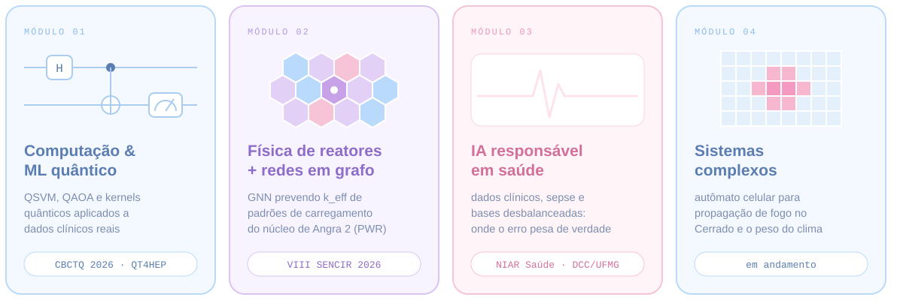
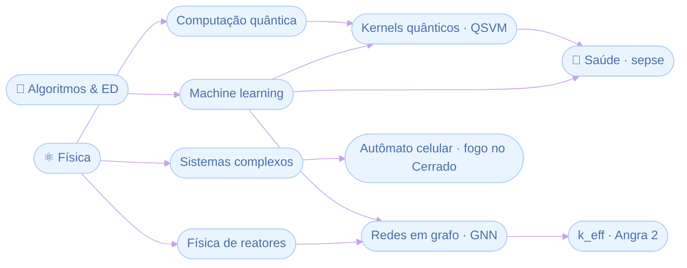

<!-- ═══════════════════════════  YASMIN.LAB  ═══════════════════════════ -->

<div align="center">
  
</div>

<div align="center">
  
</div>

<div align="center">
  <a href="https://www.youtube.com/@quantumcinna" target="_blank"></a>
  <a href="https://www.linkedin.com/in/yasmin-nimsay/" target="_blank"></a>
  <a href="https://www.instagram.com/nimsay.tech/" target="_blank"></a>
  <!-- se quiser, adicione Lattes / ORCID:
  <a href="LINK_DO_LATTES"></a>
  <a href="LINK_DO_ORCID"></a>
  -->
  <br/>
  
</div>


## `01 //` sobre a pesquisadora


Oi! Sou a **Yasmin**, estudante de Ciência da Computação na **Dom Helder** e pesquisadora no **NIAR Saúde (DCC/UFMG)**, onde trabalho com **IA responsável aplicada a dados clínicos**. Gosto dessa área porque nela o erro tem peso real: não dá pra ser descuidada.

Meu outro lado é a **física**. Estudo computação quântica (concluí a trilha avançada do **Brazil Quantum Camp**, implementei **QSVM** e **QAOA**, e o projeto do meu time ficou em **2º lugar**) e hoje também trabalho com **física de reatores**, usando redes neurais em grafo pra prever o $k_{\text{eff}}$ do núcleo de **Angra 2**.

Antes de tudo isso eu cursava **Arquitetura e Urbanismo**. A virada veio diante de uma exposição sobre a **Margaret Hamilton**, e eu nunca mais olhei pra trás. Hoje, em vez de plantas baixas, desenho padrões de carregamento de núcleo de reator. 🏛️ → ⚛️

Na faculdade sou **tutora de Algoritmos e Estruturas de Dados** e **monitora pedagógica**. Explicar algo com clareza costuma ser a melhor prova de que você entendeu.

<br clear="right"/>

## `02 //` módulos de pesquisa

<div align="center">
  
</div>

<details>
<summary><b>🗺️ mapa de como tudo se conecta</b></summary>
<br/>



</details>

## `03 //` log do laboratório

```text
[ nov/2026 ]  ✈  QT4HEP 2026 · CERN, Genebra         presenting author · QML p/ dados clínicos
[ set/2026 ]  ◆  CBCTQ 2026 · Niterói                pôster: Quantum Kernel SVM for Sepsis Detection
[   2026   ]  ☢  VIII SENCIR · artigo aceito          GNN prevendo k_eff no núcleo de Angra 2 (PWR)
[   camp   ]  ★  Brazil Quantum Camp · trilha avançada  2º lugar com o time QubitCare
[   2025   ]  ↻  Arquitetura e Urbanismo → Ciência da Computação
```

<details>
<summary><b>📄 produção científica</b></summary>
<br/>

| ano | trabalho | evento |
|:--:|:--|:--|
| 2026 | *Quantum Kernel SVM for Sepsis Detection on Imbalanced Clinical Data* | CBCTQ 2026, Niterói (pôster) |
| 2026 | Predição de $k_{\text{eff}}$ em padrões de carregamento do núcleo de Angra 2 com GNN | VIII SENCIR 2026 |
| 2026 | Aprendizado de máquina quântico para dados clínicos | QT4HEP 2026, CERN |
| em breve | Autômato celular para propagação de fogo no Cerrado | em andamento |

<!-- dica: troque os títulos pelos oficiais e linke os PDFs/DOIs quando sair -->
</details>

## `04 //` equações favoritas do lab

<table>
<tr>
<td width="33%" align="center">

**qubit na esfera de Bloch**

$$|\psi\rangle = \cos\tfrac{\theta}{2}|0\rangle + e^{i\varphi}\sin\tfrac{\theta}{2}|1\rangle$$

<sub>todo estado puro de 1 qubit é um ponto na superfície da esfera</sub>

</td>
<td width="33%" align="center">

**kernel quântico**

$$K(x,x') = \left|\langle \phi(x)\,|\,\phi(x')\rangle\right|^2$$

<sub>a "semelhança" entre dois pacientes medida no espaço de Hilbert</sub>

</td>
<td width="33%" align="center">

**fator de multiplicação**

$$k_{\text{eff}} = \frac{N_{\,i+1}}{N_{\,i}}$$

<sub>nêutrons de uma geração ÷ os da anterior: &lt;1 subcrítico · =1 crítico · &gt;1 supercrítico</sub>

</td>
</tr>
</table>

## `05 //` agora no lab

- ✈️ &nbsp;preparando a apresentação para a **QT4HEP 2026** no CERN (23–27 nov)
- ☢️ &nbsp;comparando GNN e processos gaussianos na predição de $k_{\text{eff}}$
- 🔥 &nbsp;escrevendo o artigo do autômato celular de fogo no Cerrado
- 📘 &nbsp;estudando *Nielsen & Chuang* do zero e construindo uma base sólida de física
- 🎥 &nbsp;divulgando computação quântica no [QuantumCinna](https://www.youtube.com/@quantumcinna)

## `06 //` stack

<div align="center">

**dia a dia**<br/>


<!-- no laboratório: descomente só o que você realmente usa
**no laboratório**<br/>


-->

</div>

## `07 //` painel de atividade

<div align="center">
  
  
</div>

<div align="center">
  
</div>

<picture>
  <source media="(prefers-color-scheme: dark)" srcset="https://raw.githubusercontent.com/nimsayrosie/nimsayrosie/output/pacman-contribution-graph-dark.svg">
  <source media="(prefers-color-scheme: light)" srcset="https://raw.githubusercontent.com/nimsayrosie/nimsayrosie/output/pacman-contribution-graph.svg">
  
</picture>


<details>
<summary><b>🌍 English version</b></summary>
<br/>

**Computer Science student · Researcher · Quantum & physics enthusiast**

Hi! I'm **Yasmin**, a Computer Science student at **Dom Helder** and a researcher at **NIAR Saúde (DCC/UFMG)**, where I work on **responsible AI for clinical health data**, a field where mistakes carry real weight.

My other half is **physics**. I study quantum computing (I completed the advanced track of the **Brazil Quantum Camp**, implemented **QSVM** and **QAOA**, and my team's final project placed **2nd**), and I also work on **reactor physics**, using graph neural networks to predict $k_{\text{eff}}$ for the core of the **Angra 2** PWR.

I started out in **Architecture and Urbanism** and switched to CS after seeing an exhibit about **Margaret Hamilton**. I used to draw floor plans; now I draw reactor core loading patterns.

At university I tutor **Algorithms and Data Structures** and work as a teaching assistant. Explaining something clearly is usually the best proof that you understood it.

**Recent:** poster at CBCTQ 2026 (*Quantum Kernel SVM for Sepsis Detection on Imbalanced Clinical Data*) · paper accepted at VIII SENCIR 2026 (GNN for $k_{\text{eff}}$ prediction) · presenting at **QT4HEP 2026 at CERN**.

</details>

<div align="center">
  <sub><i>"Explicar algo com clareza é a melhor prova de que você entendeu."</i></sub>
</div>


